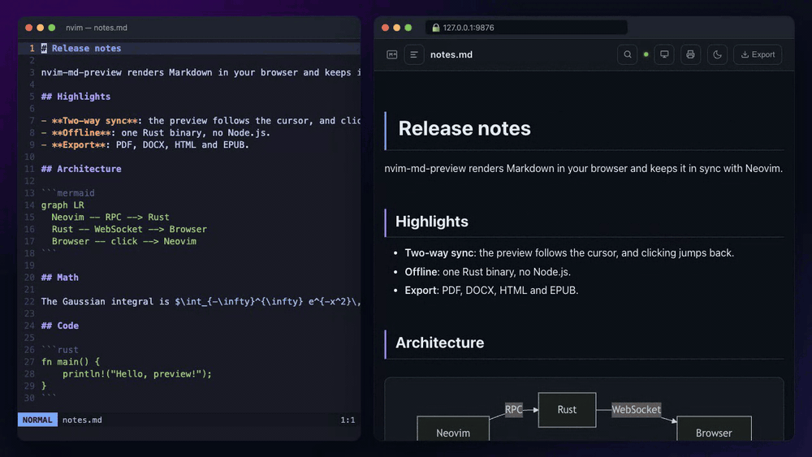
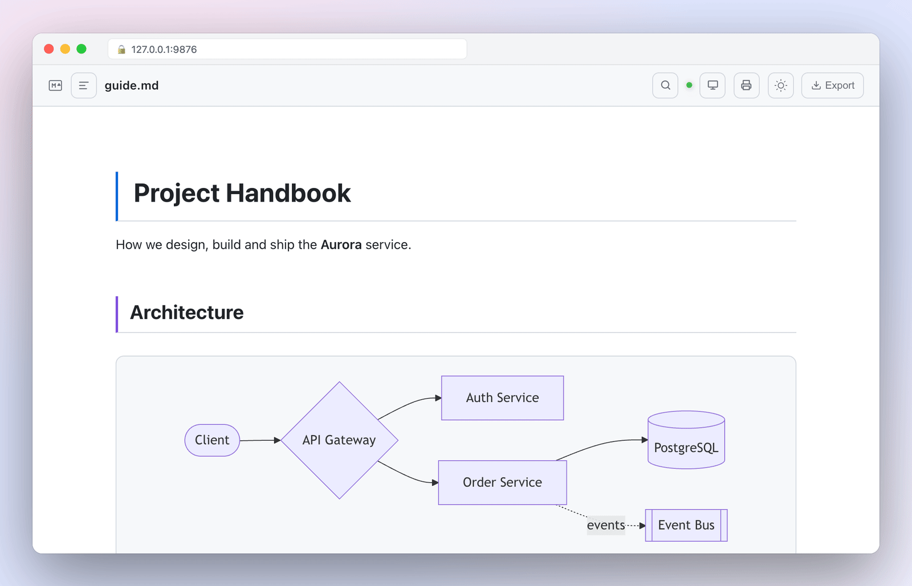
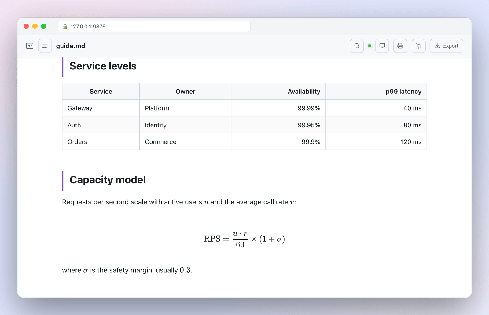
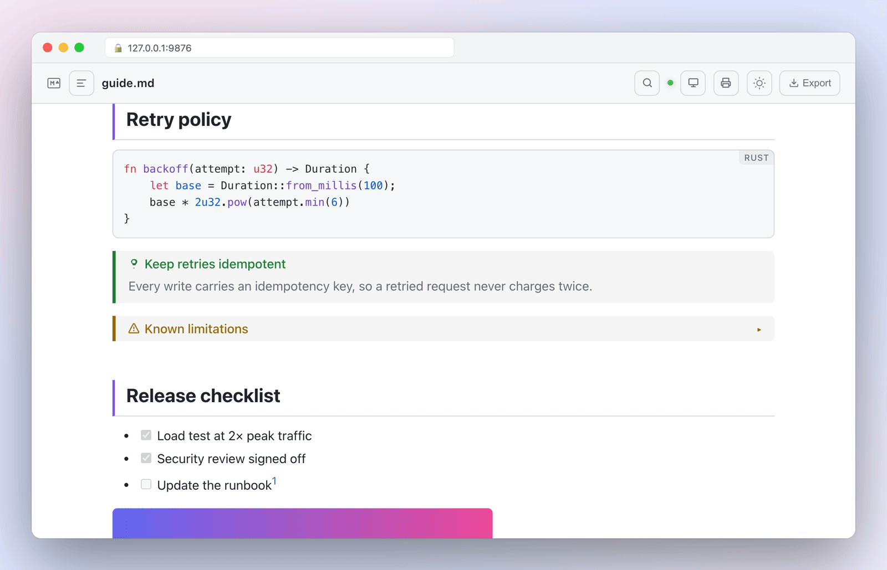
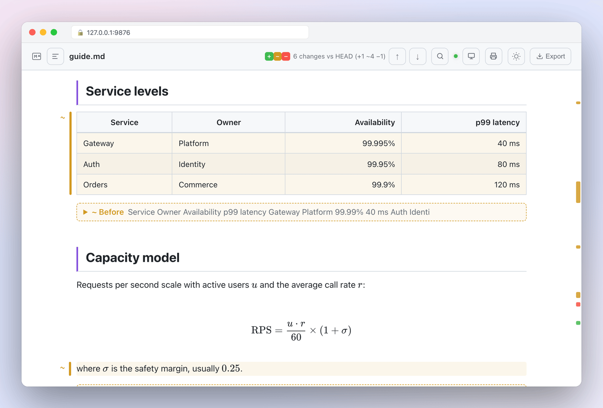
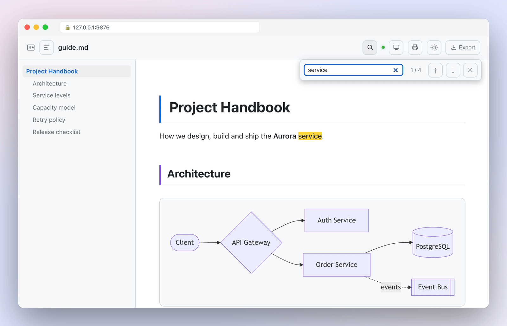
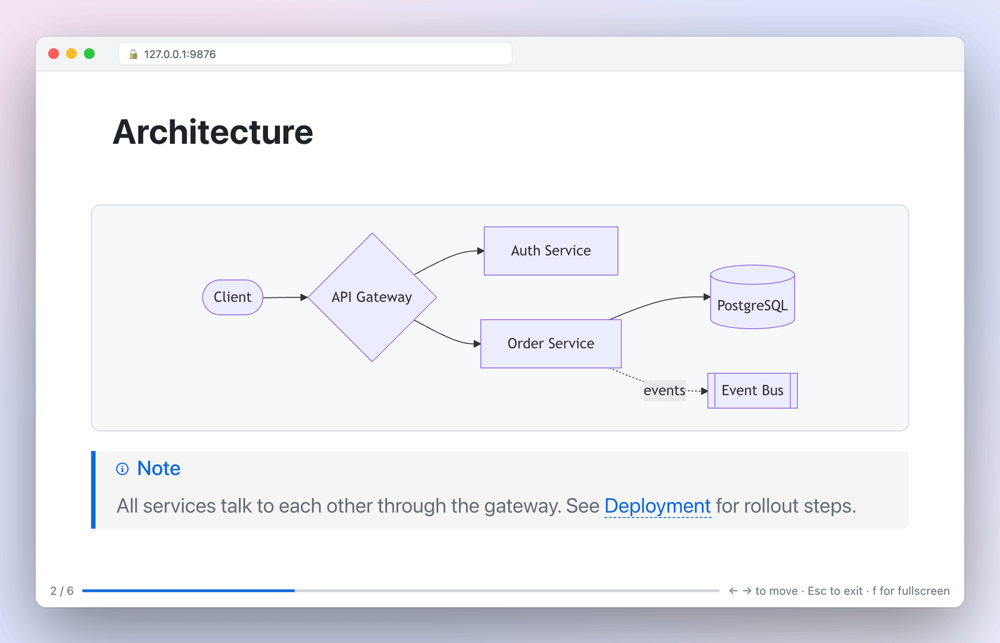
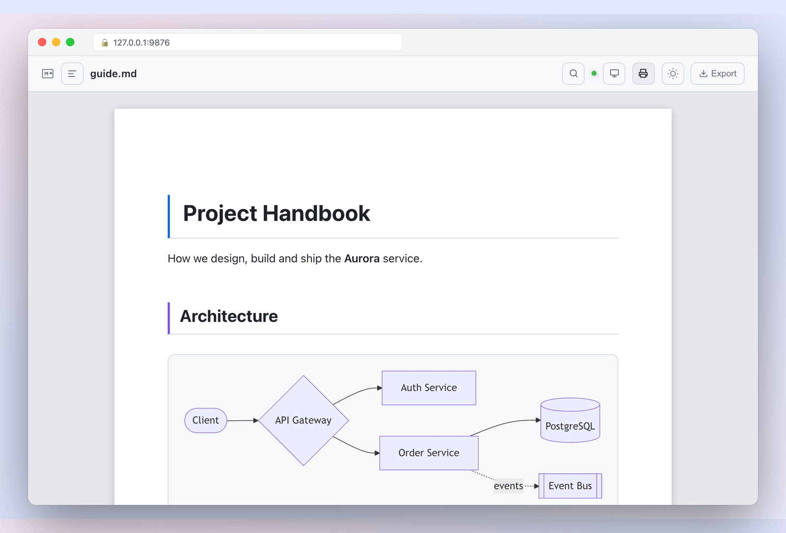

<div align="center">

# nvim-md-preview

**カーソルに追従し、クリックで戻れる Markdown プレビュー。**<br>
Rust 製の小さなバイナリ 1 つ。Node.js も Deno も不要で、オフラインで動きます。

[](https://github.com/ywsrock/nvim-md-preview/actions/workflows/ci.yml)
[](https://github.com/ywsrock/nvim-md-preview/releases/latest)
[](https://neovim.io)
[](LICENSE)

[English](README.md)



</div>

## nvim-md-preview を選ぶ理由

- **カーソルがプレビューを動かし、プレビューがカーソルを動かす。** カーソルを動かすとプレビューがブロック単位で追従し、プレビューの段落をクリックすると Neovim のその行にカーソルが移ります。
- **入れるのはバイナリ 1 つだけ。** 約 2.5 MB の Rust 製で、Mermaid・KaTeX・highlight.js・フォントを内蔵しています。Node.js も Deno も不要で、インストール後はネットワークも要りません。
- **プレビューだけでは終わらない。** PDF・DOCX・HTML・EPUB への出力、Git との差分の確認、スライドとしての発表まで、同じ画面でできます。

Neovim 0.9 以降が必要です。Vim には対応していません。

## クイックスタート

[lazy.nvim](https://github.com/folke/lazy.nvim) の場合：

```lua
{
  "ywsrock/nvim-md-preview",
  build = ":MdPreviewInstall",
  config = function()
    require("md_preview").setup({})
  end,
}
```

Markdown ファイル（またはどのテキストファイルでも）を開いて `:MarkdownPreview` を実行するだけです。起動時にはコマンドを登録するだけで、それ以外は使うときに読み込みます。

<details>
<summary>vim-plug、packer.nvim</summary>

```vim
" vim-plug: インストール後に一度 :MdPreviewInstall を実行
Plug 'ywsrock/nvim-md-preview'
```

```lua
-- packer.nvim
use { "ywsrock/nvim-md-preview", run = ":MdPreviewInstall" }
```

</details>

`:MdPreviewInstall` は、プラグインと同じ版のバイナリと、エクスポート用の pandoc・Typst を並列でダウンロードし、進捗をコマンドラインに表示します。`build` の設定をせずにプラグインを更新した場合は、バイナリが古いとプレビューの開始時に警告が出るので、もう一度 `:MdPreviewInstall` を実行してください。うまく動かないときは `:checkhealth md_preview` を実行してください。

## 他のプラグインとの比較

| | **nvim-md-preview** | [markdown-preview.nvim](https://github.com/iamcco/markdown-preview.nvim) | [peek.nvim](https://github.com/toppair/peek.nvim) |
|---|---|---|---|
| 実行環境 | Rust のバイナリ 1 つ | Node.js アプリ（ビルド済みのものか yarn でビルド） | Deno |
| Vim で使える | いいえ | はい | いいえ |
| カーソルにプレビューが追従 | ブロック単位 | はい | はい |
| プレビューのクリックで Neovim の該当行へ | **はい** | いいえ | いいえ |
| PDF / DOCX / HTML / EPUB への出力 | **内蔵** | ブラウザの印刷 | いいえ |
| 文書の Git 差分表示 | **はい** | いいえ | いいえ |
| 同じファイルでスライド | **はい** | いいえ | いいえ |

[render-markdown.nvim](https://github.com/MeanderingProgrammer/render-markdown.nvim) や [markview.nvim](https://github.com/OXY2DEV/markview.nvim) のようにバッファ内で描画するプラグインは、目的が違います。編集中はそちら、実際のページや図・数式を見たいときや出力したいときは nvim-md-preview、と併用できます。

この表は 2026 年 10 月時点の理解に基づいています。誤りがあれば [Issue](https://github.com/ywsrock/nvim-md-preview/issues) で教えてください。

## 主な機能

### 双方向の同期

スクロールの比率から推測するのではなく、元の行番号の印を使って、カーソルのあるブロックを表示し続けます。プレビューの段落をクリックすると Neovim がその行に移動します。ローカルの `.md` リンクや `[[Wiki リンク]]` も Neovim で開きます。

### オフラインで何でも描画

<picture>
  <source media="(prefers-color-scheme: dark)" srcset="docs/media/render-dark.png">
  
</picture>

Mermaid の図、KaTeX の数式、190 言語のシンタックスハイライトをバイナリに内蔵しているので、ネットワークから何も取得しません。

PlantUML のブロック（` ```plantuml ` か ` ```puml `）は、ローカルに `plantuml` コマンドがあればそれで描きます。PlantUML サーバーで描きたい場合は `plantuml_server` を設定します。図のソースがサーバーに送られるのは、これを設定したときだけです。

<table>
<tr>
<td width="50%" valign="top">

<picture>
  <source media="(prefers-color-scheme: dark)" srcset="docs/media/tables-dark.png">
  
</picture>

**表と数式。** 揃え指定つきの GitHub 形式の表、インライン・ブロックの数式。

</td>
<td width="50%" valign="top">

<picture>
  <source media="(prefers-color-scheme: dark)" srcset="docs/media/callouts-dark.png">
  
</picture>

**コード・callout・タスク。** GitHub Alerts と Obsidian の callout（折りたたみも）、タスクリスト、脚注。

</td>
</tr>
</table>

### 何が変わったかを見る

<picture>
  <source media="(prefers-color-scheme: dark)" srcset="docs/media/diff-dark.png">
  
</picture>

Git のリポジトリ内のファイルを編集すると、`HEAD` との差分（未保存の編集を含む）がすぐに表示されます。`:MdPreviewDiff main` でブランチと、`:MdPreviewDiff staged` でステージ済みの内容と比較でき、`:MdPreviewDiff off` で表示を消せます。変わった語は下線や取り消し線でその場に表示され、表や数式は変更前の内容を折りたたみで、削除された段落もその場所に残ります。ヘッダーの ↑ / ↓ で変更箇所を順に移動でき、スクロールバーの横の印で変更の位置が分かります。

### Markdown 以外のファイルも

Markdown・vimwiki・Quarto・R Markdown・MDX のファイルは文書として描画します。それ以外のテキストファイルは、行番号付きのハイライトしたコードとして表示し、スクロールの同期・クリックでの移動・検索・Git の差分はそのまま使えます。ヘルプ・ファイラー・ターミナルなどの特殊なバッファ、バイナリのファイル、2 MB を超えるファイルは表示しません。`filetypes` で対象を絞れます（例: `{ "markdown", "vimwiki" }`）。

### 長い文書でも迷わない

<picture>
  <source media="(prefers-color-scheme: dark)" srcset="docs/media/toc-search-dark.png">
  
</picture>

`t` で目次を開き、`/` か Ctrl+F で検索します。スクロールに合わせて、今いる節が強調されます。

### 発表と印刷

<table>
<tr>
<td width="50%" valign="top">

<picture>
  <source media="(prefers-color-scheme: dark)" srcset="docs/media/slides-dark.png">
  
</picture>

**スライド。** `p` で文書をスライドとして発表します。`---` か見出しで区切り、カーソルに追従します。

</td>
<td width="50%" valign="top">

<picture>
  <source media="(prefers-color-scheme: dark)" srcset="docs/media/print-dark.png">
  
</picture>

**印刷プレビュー。** 改ページの目安つきの A4 の紙面で確認して、ブラウザから印刷します。

</td>
</tr>
</table>

### 出力

`:MdPreviewExport pdf` で、**プレビューと同じ見た目の PDF**（図・数式・callout・色付きのコードを含む）をファイルの隣に書き出します。PC に入っている Chrome・Edge・Brave・Chromium のいずれかで、画面を出さずにプレビューを印刷します。用紙サイズ・余白・フォント・目次・見出し番号は設定に従います。DOCX・HTML・EPUB は pandoc で出力します。未保存の編集も含まれます。

> [!NOTE]
> これらのブラウザが無い場合は、Typst で PDF を作ります（どちらを使うかは `:checkhealth md_preview` で分かります）。Typst の出力は独自のテンプレートに対応しますが、Mermaid の図・数式・callout は描画されません。

## レシピ

<details open>
<summary><b>キーの割り当て</b></summary>

```lua
{
  "ywsrock/nvim-md-preview",
  lazy = false, -- どのバッファでもコマンドを使えるようにする（keys だけだと遅延読み込みになる）
  build = ":MdPreviewInstall",
  config = function() require("md_preview").setup({}) end,
  keys = {
    { "<leader>mp", "<cmd>MarkdownPreviewToggle<cr>", desc = "Markdown: プレビュー" },
    { "<leader>md", "<cmd>MdPreviewDiff<cr>", desc = "Markdown: Git の差分" },
    {
      "<leader>me",
      function()
        vim.ui.select({ "pdf", "docx", "html", "epub" }, { prompt = "出力形式" }, function(format)
          if format then vim.cmd("MdPreviewExport " .. format) end
        end)
      end,
      desc = "Markdown: エクスポート",
    },
  },
}
```

</details>

<details>
<summary><b>プレビューを自動で開始する</b></summary>

最初に開いた Markdown ファイルで開始します。`follow_buffer`（既定で有効）により、その後は今いる Markdown バッファにプレビューが切り替わります。

```lua
vim.api.nvim_create_autocmd("FileType", {
  pattern = "markdown",
  once = true,
  command = "MarkdownPreview",
})
```

</details>

<details>
<summary><b>Obsidian の Vault でメモを書く</b></summary>

`[[Page]]` / `[[Page|表示名]]` のリンクと Obsidian の callout（`> [!info] タイトル`、折りたたみの `> [!todo]-`）は設定なしで使えます。Wiki リンクをクリックすると、大文字小文字・空白・`-`・`_` の違いを無視してノートを探し、Neovim で開きます。見た目は `custom_css = "~/notes/preview.css"` で変えられます。

</details>

<details>
<summary><b>PR のドキュメントをレビューする</b></summary>

ブランチをチェックアウトして `:MdPreviewDiff main` を実行します。`main` から変わった段落すべてに印が付き、プレビューのヘッダーの ↑ / ↓ で順に確認できます。`:MdPreviewDiff staged` でコミット予定の内容、`:MdPreviewDiff off` で表示を消します。

</details>

<details>
<summary><b>会社の書式で PDF を渡す</b></summary>

ブラウザで作る PDF（既定）はプレビューのスタイルをそのまま使うので、`custom_css` に印刷用の指定を書くだけで変えられます。

```css
/* ~/.config/nvim/preview.css */
@media print {
  #content { font-family: "Noto Sans CJK JP", sans-serif; }
  #content h1 { color: #0b3d91; }
}
```

```lua
require("md_preview").setup({
  custom_css = "~/.config/nvim/preview.css",
  export = { paper = "a4", toc = true, numbering = true },
})
```

ページ全体を細かく作り込みたいときは、Typst とテンプレートを使います。

```lua
require("md_preview").setup({
  export = { pdf_engine = "typst", template = "~/.config/nvim/report.typ" },
})
```

```typst
// ~/.config/nvim/report.typ
#let template(doc) = {
  set page(header: align(right)[社外秘])
  set text(font: "Noto Sans CJK JP", size: 10pt)
  doc
}
```

あとは `:MdPreviewExport pdf` です。相対パスの画像は文書のフォルダから探します。

</details>

<details>
<summary><b>タブレットで一緒に見る</b></summary>

`host = "0.0.0.0"` にします。プレビューを開始するたびに、使い捨てのトークン付きの LAN の URL が Neovim に表示されます。タブレットでそれを開くと、PC のブラウザと同じようにカーソルに追従します。

</details>

## 使い方

| コマンド | |
|---|---|
| `:MarkdownPreview` / `:MdPreview` | プレビューを開始 |
| `:MarkdownPreviewStop` / `:MdPreviewStop` | 停止 |
| `:MarkdownPreviewToggle` | 開始 / 停止を切り替え |
| `:MdPreviewExport {形式} [path]` | バッファを出力：`pdf` `docx` `html` `epub` `markdown`。`path` を省略するとファイルの隣に保存 |
| `:MdPreviewDiff [基準]` | Git の差分の表示を切り替え。`基準`（`HEAD`、`staged`、ブランチ・タグ・コミット）を指定するとそれと比較。`off` で非表示 |
| `:MdPreviewInfo [copy]` | プレビューの URL、対象のファイル、PDF と PlantUML に使うものを表示。`copy` で URL をコピー |
| `:MdPreviewInstall` | バイナリ・pandoc・Typst をダウンロード / 更新 |

プレビューでは、`t` で目次、`/` か Ctrl+F で検索、`p` でスライド、クリックで該当行へ移動します。ツールバーのボタンでも同じ操作ができます。これらのキーが Vimium などのブラウザ拡張とぶつかる場合は `browser_keys = false` にしてください（[FAQ](#faq) を参照）。

詳しくは `:help md_preview` を見てください。

## 設定

設定はすべて省略できます。変えたいものだけを `setup()` に渡してください。

```lua
require("md_preview").setup({
  theme = "light",
  git_diff_base = "main",
  export = { paper = "us-letter", toc = true },
})
```

### 全般

| 設定 | 既定値 | 説明 |
|---|---|---|
| `filetypes` | `{ "*" }` | プレビューできるファイルの種類（Neovim の `filetype`）。`"*"` はすべてのファイル。Markdown・vimwiki・Quarto・R Markdown・pandoc・MDX は文書として描画し、それ以外はハイライトしたコードとして表示します。特殊なバッファ（ヘルプ・ファイラー・ターミナル）は対象外です。 |
| `max_file_size` | `2097152`（2 MB） | これより大きいファイル（バイト）は表示しません。バイナリのファイルは常に表示しません。 |
| `port` | `9876` | プレビューのサーバーのポート。使用中なら次の空きポートを使います。 |
| `host` | `"127.0.0.1"` | 待ち受けるアドレス。`"0.0.0.0"` にすると LAN 内の別端末から見られます。その場合はトークンが必要になります（[レシピ](#レシピ)の「タブレットで一緒に見る」を参照）。 |
| `auto_open` | `true` | プレビューの開始時にブラウザを開きます。 |
| `binary` | `stdpath("data")/nvim-md-preview/` にダウンロードしたもの | プレビュー用バイナリのパス。ソースからビルドしたときに指定します。 |
| `log_file` | `""` | ログを追記するファイル。起動と停止、ポート、使うツール、出力の結果、バイナリのエラーを記録します。文書の内容は書かず、LAN 用のトークンは伏せます。空なら何も書きません。バグ報告に便利です。 |

### プレビュー

| 設定 | 既定値 | 説明 |
|---|---|---|
| `scroll_sync` | `true` | カーソルのあるブロックにプレビューをスクロールします。 |
| `follow_buffer` | `true` | 別の Markdown バッファに移ったら、プレビューを切り替えます。 |
| `debounce_ms` | `80` | 入力が止まってからプレビューを更新するまでの待ち時間（ミリ秒）。 |
| `theme` | `"auto"` | `"auto"`（OS の設定に従う）、`"dark"`、`"light"`。プレビューのボタンで切り替えた場合は、そちらを記憶して優先します。 |
| `custom_css` | `""` | 組み込みスタイルの後に読み込む CSS ファイルのパス。組み込みのスタイルを上書きできます。 |
| `wiki_links` | `true` | `[[Page]]` と `[[Page\|表示名]]` を、Neovim で開けるリンクにします。 |
| `browser_keys` | `true` | プレビュー画面のキーボードショートカット（`t`、`/`、Ctrl+F、`p`）。Vimium などのブラウザ拡張とぶつかる場合は `false` にします（[FAQ](#faq) を参照）。 |

### Git の差分

| 設定 | 既定値 | 説明 |
|---|---|---|
| `git_diff` | `true` | `git_diff_base` との差分をプレビューに表示します。`:MdPreviewDiff` で切り替えます。Git の管理外のファイルでは何も表示しません。 |
| `git_diff_base` | `"HEAD"` | 比較の基準：`"HEAD"`、`"staged"`（ステージ済みの内容）、ブランチ・タグ・コミット。`:MdPreviewDiff <基準>` でその場だけ変えられます。 |
| `git_diff_colors` | `true` | 差分の色をエディタ（`GitSignsAdd`、`Added`、`DiffAdd` など）に合わせます。プレビューのテーマで読みにくい色の場合は、緑・黄・赤を使います。 |

### PlantUML

| オプション | 既定値 | 説明 |
|---|---|---|
| `plantuml_path` | `""` | ` ```plantuml ` と ` ```puml ` のブロックを描く `plantuml` コマンド、または `plantuml.jar`（`java -jar` で実行）。空なら `PATH` 上の `plantuml` を使います。見つからなければコードのまま表示します。 |
| `plantuml_server` | `""` | PlantUML サーバーの URL（例: `"https://www.plantuml.com/plantuml"`）。設定すると `plantuml` を実行せず、ブラウザがこのサーバーから図を読み込みます。図のソースは手元のマシンの外に出ます。空ならサーバーは使いません。 |

### 出力（`export = { ... }`）

| 設定 | 既定値 | 説明 |
|---|---|---|
| `formats` | `{ "pdf", "docx", "html", "epub", "markdown" }` | プレビューの Export メニューと `:MdPreviewExport` の補完に出す形式。`{}` にすると Export ボタンを隠します。 |
| `pdf_engine` | `"browser"` | PDF の作り方。`"browser"` は Chrome・Edge・Brave・Chromium でプレビューを印刷するので、プレビューと同じ見た目になります。これらが無ければ Typst を使います。`"typst"` は常に Typst を使います（`template` に対応。図・数式・callout は描画されません）。 |
| `browser_path` | `""` | PDF の作成に使うブラウザ。空なら、Chrome・Edge・Brave・Chromium を標準の場所と `PATH` から探します。 |
| `docx_engine` | `"pandoc"` | `"pandoc"` なら `:MdPreviewInstall` で DOCX・HTML・EPUB 用の pandoc をダウンロードします。それ以外の値ではダウンロードしません。 |
| `pandoc_path` | `""` | pandoc のパス。空ならダウンロードしたもの、次に `PATH` 上の `pandoc` を使います。 |
| `typst_path` | `""` | Typst のパス。空ならダウンロードしたもの、次に `PATH` 上の `typst` を使います。 |
| `paper` | `"a4"` | PDF の用紙サイズ。`"us-letter"` や `"a5"` など、Typst の用紙名を指定します。 |
| `margin` | `"2cm"` | PDF の余白。 |
| `font` | `""` | PDF の本文フォント。空なら Noto Serif CJK JP などを使います。 |
| `font_size` | `11` | PDF の本文サイズ（pt）。 |
| `toc` | `false` | 目次を入れます（PDF・DOCX・HTML・EPUB）。 |
| `numbering` | `false` | 見出しに番号を付けます（PDF・DOCX・HTML・EPUB）。 |
| `template` | `""` | `template` 関数を export した Typst ファイル。`pdf_engine = "typst"` のとき PDF 全体に適用します（[レシピ](#レシピ)を参照）。 |

### Vimscript

`setup()` を呼ばない場合は、プラグインの読み込み時に次の変数を読みます。

| 変数 | 対応する設定 |
|---|---|
| `g:md_preview_port` | `port` |
| `g:md_preview_auto_open` | `auto_open`（`0` で無効） |

<details>
<summary>すべての設定と既定値（コピー用）</summary>

```lua
require("md_preview").setup({
  filetypes = { "*" },
  max_file_size = 2 * 1024 * 1024,
  binary = vim.fn.stdpath("data") .. "/nvim-md-preview/nvim-md-preview",
  port = 9876,
  host = "127.0.0.1",
  auto_open = true,
  log_file = "",

  scroll_sync = true,
  follow_buffer = true,
  debounce_ms = 80,
  theme = "auto",
  custom_css = "",
  wiki_links = true,
  browser_keys = true,

  git_diff = true,
  git_diff_base = "HEAD",
  git_diff_colors = true,

  plantuml_path = "",
  plantuml_server = "",

  export = {
    formats = { "pdf", "docx", "html", "epub", "markdown" },
    pdf_engine = "browser",
    browser_path = "",
    docx_engine = "pandoc",
    pandoc_path = "",
    typst_path = "",
    paper = "a4",
    margin = "2cm",
    font = "",
    font_size = 11,
    toc = false,
    numbering = false,
    template = "",
  },
})
```

</details>

## markdown-preview.nvim との互換性

nvim-md-preview は、markdown-preview.nvim と同じコマンド名（`:MarkdownPreview`、`:MarkdownPreviewStop`、`:MarkdownPreviewToggle`）を使います。markdown-preview.nvim の各設定に対応するものは次のとおりです。

| markdown-preview.nvim | nvim-md-preview |
|---|---|
| `build = "cd app && npx --yes yarn install"` | `build = ":MdPreviewInstall"` |
| `g:mkdp_port` | `port` |
| `g:mkdp_theme` | `theme` |
| `g:mkdp_markdown_css` | `custom_css` |
| `g:mkdp_open_to_the_world = 1` | `host = "0.0.0.0"`（トークンで保護） |
| `g:mkdp_preview_options.disable_sync_scroll = 1` | `scroll_sync = false` |
| `g:mkdp_auto_start = 1` | [自動で開始するレシピ](#レシピ) |
| `g:mkdp_browser` | まだ対応していません。`auto_open = false` にして URL を自分で開いてください |

## FAQ

### プレビュー画面でショートカットキーが効かない、または新しいタブが開いてしまう

Vimium、Vimium C、Tridactyl、Surfingkeys など、ブラウザに Vim 風のキー操作を追加する拡張機能は、プレビュー画面と同じキーを使っています。

| キー | プレビュー | Vim 系の拡張機能 |
|---|---|---|
| `t` | 目次 | 新しいタブを開く（Vimium、Tridactyl） |
| `/` | 検索 | ページ内検索（Vimium）、クイック検索（Firefox） |
| `p` | プレゼンモード | クリップボードの URL を開く（Vimium、Tridactyl） |
| `f`（スライド中） | 全画面 | リンクヒント |

通常は拡張機能が先にキーを受け取るため、プレビュー画面にはキーが届きません。次のどちらかで対処できます。

- **プレビュー画面のショートカットを無効にする**（ツールバーのボタンで操作します）：

  ```lua
  require("md_preview").setup({ browser_keys = false })
  ```

- **プレビュー画面でだけ拡張機能を無効にする**（プレビュー画面のキーが使えるようになります）：
  - Vimium / Vimium C：オプションの除外 URL のルールに `http://127.0.0.1:*/*` を追加します。拡張機能は使いつつ一部のキーだけ通したい場合は、「Keys」に `t / p` のように指定します。
  - Tridactyl：`:blacklistadd 127.0.0.1` を実行します。
  - Surfingkeys：設定に `settings.blocklistPattern = /127\.0\.0\.1/;` を追加します。

  `port` を変えている場合や LAN モードの場合は、アドレスを読み替えてください。

### Windows と WSL の両方で Neovim を使っています。ブラウザにはどちらのプレビューが出ますか？

Neovim ごとに別々のプレビューサーバーが動きます。WSL と Windows は `localhost` のネットワークが別ですが、ブラウザは Windows で動くので、WSL ではサーバーが Windows 側で使用中のポートを避けます（`netstat.exe` で確認します。`:checkhealth md_preview` を見てください）。それでも別の Neovim のプレビューにつながった場合は、その内容は出さずに「Another preview is using this port」と表示します。そのときは `port` を変えてください。

### 文書がどこかに送られることはありますか？

ありません。サーバーは `127.0.0.1` でのみ待ち受け、必要なものはすべてバイナリに入っています。[セキュリティ](#セキュリティ)を見てください。例外は `plantuml_server` だけで、これを設定すると PlantUML の図のソースがそのサーバーに送られます。

## 仕組み

```
Neovim ──msgpack-rpc (stdin/stdout)──▶ Rust バイナリ ──WebSocket──▶ ブラウザ
   ▲                                     │ pulldown-cmark → HTML          │
   └──────── クリック / リンクを開く ─────┴─────────────────────────────────┘
```

Lua 側がバッファの内容（デバウンス済み）とカーソル行を送ります。バイナリは Markdown を元の行番号の印つきの HTML に変換し、`127.0.0.1` でページを配信して、更新を WebSocket で送ります。プレビューでのクリックは同じ経路で Neovim に戻ります。

## セキュリティ

`host` を変えない限り `127.0.0.1` でのみ待ち受けます。`Host` がループバック以外のリクエスト（DNS rebinding）と、他のオリジンからのリクエスト・WebSocket はすべて拒否するので、ブラウザで開いている他のサイトがファイルを読んだり Neovim を操作したりすることはできません。`/assets` は文書のディレクトリ内のファイルだけを返します。LAN モードでは全リクエストにセッションのトークンが必要です。

v0.1.0 までは、プレビュー中に他のサイトからローカルファイルを読み取れる問題がありました。`:MdPreviewInstall` で更新してください。

## 開発に参加する

バグ報告・アイデア・プルリクエストを歓迎します。ソースからのビルド、テスト、リリースの流れは [CONTRIBUTING.md](CONTRIBUTING.md) を見てください。

```bash
git clone https://github.com/ywsrock/nvim-md-preview
cd nvim-md-preview
bash download-libs.sh && cargo build --release
```

## 謝辞

- [selimacerbas/mdkite.nvim](https://github.com/selimacerbas/mdkite.nvim) — プレビュー画面のスタイル・Mermaid の描画・テーマ設計を参考にしました。
- [iamcco/markdown-preview.nvim](https://github.com/iamcco/markdown-preview.nvim) — インストール方式・コマンド名・設定インターフェースを参考にしました。

## ライセンス

MIT
