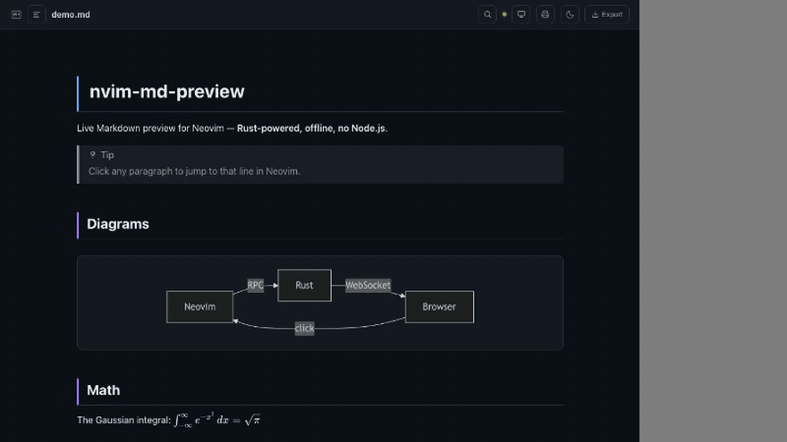

# nvim-md-preview

Neovim 用の Markdown ライブプレビューです。Rust 製のバイナリ 1 つで動き、完全にオフラインで使えます。Node.js や Deno は不要です。

[English](README.md)



- **正確な双方向同期**：カーソルのあるブロックにプレビューが追従します。プレビューの段落をクリックすると、Neovim のその行に移動します。
- **長い文書でも軽い**：変わったブロックだけを描き直すので、入力中も図やスクロール位置が保たれます。
- **オフラインで動く**：Mermaid、KaTeX、highlight.js、フォントをバイナリに内蔵しています。
- **エクスポート内蔵**：PDF（Typst）、DOCX / HTML / EPUB（pandoc）、Markdown。ブラウザからでも `:MdPreviewExport` からでも出力でき、未保存の編集も含まれます。
- **長文向けの機能**：目次、ページ内検索、脚注のポップアップ、プレゼンモード、印刷プレビュー。
- **安全な既定値**：`127.0.0.1` でのみ待ち受け、他のサイトからのリクエストを拒否します。LAN で共有する場合はセッションごとのトークンが必要です。

## 機能

| | |
|---|---|
| 描画 | GFM の表・タスクリスト・脚注・取り消し線、Mermaid、KaTeX 数式（`$...$`, `$$...$$`）、シンタックスハイライト（190 言語）、絵文字 `:smile:`、YAML front matter |
| Callout | GitHub Alerts（`> [!NOTE]`）と Obsidian の callout（`> [!info] タイトル`、折りたたみ `> [!todo]-`） |
| リンク | Wiki リンク `[[Page]]` / `[[Page\|表示名]]`。ローカルの `.md` リンクと Wiki リンクは Neovim で開く |
| 同期 | ブロック単位のスクロール同期、クリックで該当行へ移動、切り替えた Markdown バッファに追従 |
| ナビゲーション | 目次パネル（`t`）、検索（`/` か Ctrl+F）、見出しアンカー |
| モード | プレゼンモード（`p`、`---` でスライドを区切る）、A4 の改ページ目安つき印刷プレビュー |
| Git | `:MdPreviewDiff` で `HEAD` から変わったブロックに印を付ける |
| エクスポート | PDF / DOCX / HTML / EPUB / Markdown。用紙サイズ、余白、フォント、目次、見出し番号、Typst テンプレートを指定可能 |
| 見た目 | ダーク / ライト / 自動のテーマ、カスタム CSS |
| 対応環境 | Linux（x86_64, arm64）、macOS（Intel, Apple Silicon）、Windows、WSL |

## 動作環境

- Neovim 0.9 以降
- バイナリのダウンロードに `curl`（または `wget` / PowerShell）。pandoc と Typst の展開に使う `tar` は、macOS・Linux・Windows 10 以降に標準で入っています。

## インストール

### lazy.nvim

```lua
{
  "ywsrock/nvim-md-preview",
  ft = "markdown",
  build = ":MdPreviewInstall",
  config = function()
    require("md_preview").setup({})
  end,
}
```

### vim-plug

```vim
Plug 'ywsrock/nvim-md-preview'
```

インストール後に一度 `:MdPreviewInstall` を実行してください。

### packer.nvim

```lua
use { "ywsrock/nvim-md-preview", run = ":MdPreviewInstall" }
```

`:MdPreviewInstall` は、プレビュー用のバイナリと pandoc・Typst を並列でダウンロードし、進捗をコマンドラインに表示します。実行しなかった場合は、初めて `:MarkdownPreview` を実行したときにバイナリをダウンロードします。

うまく動かないときは `:checkhealth md_preview` を実行してください。

## 使い方

Markdown ファイルを開いて `:MarkdownPreview` を実行します。

| コマンド | |
|---|---|
| `:MarkdownPreview` / `:MdPreview` | プレビューを開始 |
| `:MarkdownPreviewStop` / `:MdPreviewStop` | 停止 |
| `:MarkdownPreviewToggle` | 開始 / 停止を切り替え |
| `:MdPreviewExport {形式} [path]` | 現在のバッファを出力：`pdf` `docx` `html` `epub` `markdown`。`path` を省略するとファイルと同じ場所に保存 |
| `:MdPreviewDiff` | Git の `HEAD` からの変更を表示 / 非表示 |
| `:MdPreviewInstall` | バイナリ・pandoc・Typst をダウンロード / 更新 |

ブラウザでの操作：

| キー | |
|---|---|
| `t` | 目次の開閉 |
| `/`、Ctrl+F | 検索（Enter / Shift+Enter で移動、Esc で閉じる） |
| `p` | プレゼンモード（矢印キーで移動、`f` で全画面、Esc で終了） |
| 段落をクリック | Neovim のその行へ移動 |

## 設定

既定値を示します。変えたいものだけ渡してください。

```lua
require("md_preview").setup({
  port = 9876,            -- 使用中なら次の空きポートを使う
  host = "127.0.0.1",     -- "0.0.0.0" で LAN 内の別端末から見られる（トークンが自動で必須になる）
  auto_open = true,       -- 開始時にブラウザを開く
  scroll_sync = true,     -- カーソルに合わせてプレビューをスクロール
  follow_buffer = true,   -- 別の Markdown バッファに移ったらプレビューを切り替える
  debounce_ms = 80,       -- 入力が止まってから更新するまでの待ち時間
  theme = "auto",         -- "auto"（OS の設定に従う）| "dark" | "light"
  custom_css = "",        -- 組み込みスタイルの後に読み込む CSS ファイル
  wiki_links = true,      -- [[Page]] をリンクにする
  git_diff = false,       -- HEAD からの変更に印を付ける（:MdPreviewDiff で切り替え）

  export = {
    pdf_engine  = "typst",  -- "typst"。それ以外にすると Typst をダウンロードしない
    docx_engine = "pandoc", -- "pandoc"。それ以外にすると pandoc をダウンロードしない
    pandoc_path = "",       -- 空ならダウンロードしたもの、次に PATH 上のものを使う
    typst_path  = "",
    paper     = "a4",       -- PDF の用紙（Typst の用紙名。例: "us-letter"）
    margin    = "2cm",
    font      = "",         -- 空なら Noto Serif CJK JP など
    font_size = 11,
    toc       = false,      -- 目次（PDF と pandoc の形式）
    numbering = false,      -- 見出し番号
    template  = "",         -- `template` を export した Typst ファイル（下記）
  },
})
```

Vimscript では `g:md_preview_port` と `g:md_preview_auto_open` も使えます。

### PDF のテンプレート

`export.template` には、`template` 関数を export した Typst ファイルを指定します。文書全体に show ルールとして適用されます。

```typst
// ~/.config/nvim/md-template.typ
#let template(doc) = {
  set page(paper: "a4", header: align(right)[社外秘])
  set text(font: "Noto Sans CJK JP", size: 10pt)
  doc
}
```

### タブレットや別の PC から見る

`host = "0.0.0.0"` にします。プレビューを開始するたびにランダムなトークンが作られ、LAN の URL が Neovim に表示されます。その URL を開いたブラウザだけがアクセスできます。

## 仕組み

```
Neovim ──msgpack-rpc (stdin/stdout)──▶ Rust バイナリ ──WebSocket──▶ ブラウザ
   ▲                                     │ pulldown-cmark → HTML          │
   └──────── クリック / リンクを開く ─────┴─────────────────────────────────┘
```

Lua 側がバッファの内容（デバウンス済み）とカーソル行を送ります。バイナリは Markdown を元の行番号の印つきの HTML に変換し、`127.0.0.1` でページを配信して、更新を WebSocket で送ります。プレビューでのクリックは同じ経路で Neovim に戻ります。

## セキュリティ

`host` を変えない限り `127.0.0.1` でのみ待ち受けます。`Host` がループバック以外のリクエスト（DNS rebinding）と、他のオリジンからのリクエスト・WebSocket はすべて拒否するので、ブラウザで開いている他のサイトがファイルを読んだり Neovim を操作したりすることはできません。`/assets` は文書のディレクトリ内のファイルだけを返します。LAN モードでは全リクエストにセッションのトークンが必要です。

v0.1.0 までは、プレビュー中に他のサイトからローカルファイルを読み取れる問題がありました。`:MdPreviewInstall` で更新してください。

## ソースからビルド

```bash
git clone https://github.com/ywsrock/nvim-md-preview
cd nvim-md-preview
bash download-libs.sh      # バイナリに埋め込む JS / CSS ライブラリを取得
cargo build --release
```

ビルドしたバイナリを指定します：

```lua
require("md_preview").setup({ binary = "/path/to/nvim-md-preview/target/release/nvim-md-preview" })
```

テストや開発の流れは [CONTRIBUTING.md](CONTRIBUTING.md) を見てください。

## 謝辞

- [selimacerbas/mdkite.nvim](https://github.com/selimacerbas/mdkite.nvim) — プレビュー画面のスタイル・Mermaid の描画・テーマ設計を参考にしました。
- [iamcco/markdown-preview.nvim](https://github.com/iamcco/markdown-preview.nvim) — インストール方式・コマンド名・設定インターフェースを参考にしました。

## ライセンス

MIT
