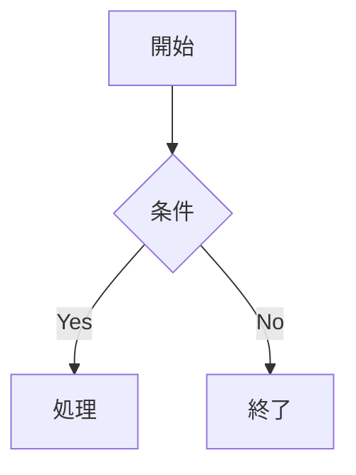

# nvim-md-preview

Neovim 用 Markdown プレビュープラグイン。Rust 製のローカル HTTP サーバーでブラウザにリアルタイムプレビューを提供します。


## 特徴

- ⚡ リアルタイムプレビュー（WebSocket）
- 🎨 Mermaid ダイアグラム（フローチャート、シーケンス図など）
- 📐 KaTeX 数式レンダリング（`$...$`, `$$...$$`）
- 🖍️ シンタックスハイライト（highlight.js、190言語対応）
- 🌙 ダーク / ライトテーマ切り替え
- 📜 スクロール同期（カーソル追従）
- 🔗 見出しアンカーリンク
- ⚠️ GitHub Alerts（`> [!NOTE]` など）
- 😊 絵文字（`:smile:` → 😊）
- 📦 YAML front matter パネル表示
- 🖼️ 相対パス画像の自動解決
- 📡 オフライン完全動作（JS/CSS をバイナリに埋め込み済み）

## 動作環境

| OS | 対応 |
|---|---|
| Linux | ✅ |
| macOS (Intel / Apple Silicon) | ✅ |
| Windows (WSL) | ✅ |
| Windows ネイティブ | ❌（WSL 推奨） |

---

## インストール

### lazy.nvim（推奨）

```lua
{
  "ywsrock/nvim-md-preview",
  ft = "markdown",
  build = ":MdPreviewInstall",
  config = function()
    require("md_preview").setup()
  end,
}
```

### Vundle

```vim
" ~/.config/nvim/init.vim の Plugin 定義に追加
Plugin 'ywsrock/nvim-md-preview'
```

`:PluginInstall` 後、初回の `:MdPreview` 実行時にバイナリを自動ダウンロードします。
または手動で `:MdPreviewInstall` を実行してください。

### vim-plug

```vim
Plug 'ywsrock/nvim-md-preview'
```

`:PlugInstall` 後、`:MdPreviewInstall` を実行してください。

### packer.nvim

```lua
use {
  "ywsrock/nvim-md-preview",
  run = ":MdPreviewInstall",
  config = function()
    require("md_preview").setup()
  end,
}
```

---

## 使い方

Markdown ファイルを開いて:

```vim
:MdPreview        " プレビュー開始（ブラウザが自動で開く）
:MdPreviewStop    " プレビュー停止
:MdPreviewInstall " バイナリを手動でダウンロード
```

---

## 設定

```lua
require("md_preview").setup({
  port     = 9876,  -- HTTP サーバーのポート番号（デフォルト: 9876）
  auto_open = true, -- プレビュー開始時に自動でブラウザを開く（デフォルト: true）
})
```

---

## Mermaid ダイアグラム

````markdown

````

## 数式 (KaTeX)

```markdown
インライン: $E = mc^2$

ブロック:
$$
\int_{-\infty}^{\infty} e^{-x^2} dx = \sqrt{\pi}
$$
```

## GitHub Alerts

```markdown
> [!NOTE]
> 補足情報です。

> [!WARNING]
> 注意が必要な情報です。

> [!TIP]
> ヒントです。
```

---

## 仕組み

```
Neovim (バッファ変更)
  ↓ RPC (stdin/stdout)
Rust バイナリ
  ├── pulldown-cmark で Markdown → HTML 変換
  ├── HTTP/WebSocket サーバー (axum)
  └── JS/CSS/フォントをバイナリ内蔵（オフライン対応）
       ↓ WebSocket
ブラウザ（リアルタイム更新）
```

---

## 開発者向け（ソースからビルド）

```bash
git clone https://github.com/ywsrock/nvim-md-preview
cd nvim-md-preview

# JS ライブラリをダウンロード（初回のみ）
bash download-libs.sh

# ビルド
cargo build --release
```

`init.vim` にパスを設定:

```vim
lua require("md_preview").setup({
\  binary = vim.fn.expand("~/.vim/bundle/nvim-md-preview/target/release/nvim-md-preview"),
\ })
```

---

## ライセンス

MIT
